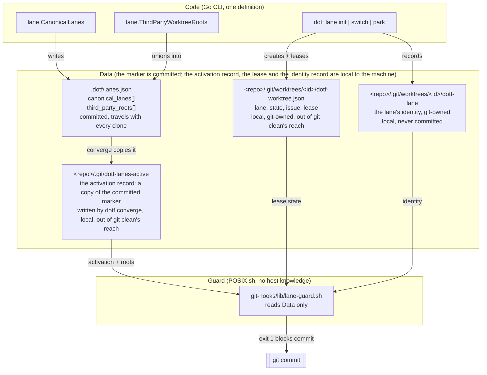
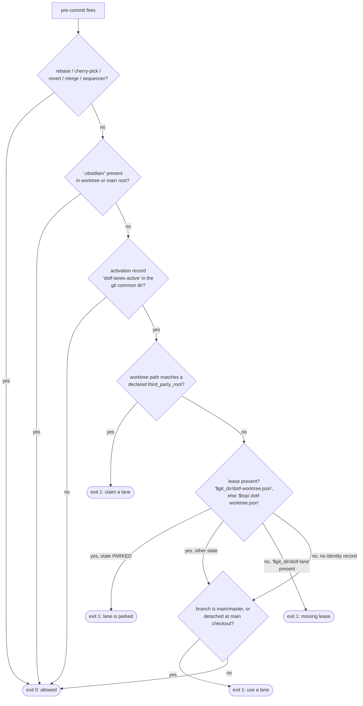
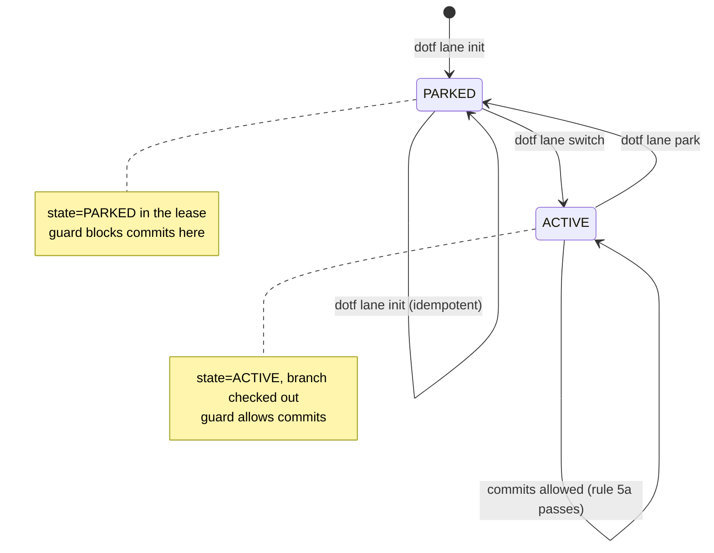

# Persistent named lanes, sticky personas and the pre-commit lane guard

Operational guide for the persistent named lane system (HARNESS-186, ADR-060):
what it is, how it decides, how to activate it in a repository, and how to prove
it works on any OS, agent host and seat.

The system is deliberately agnostic. Nothing in the guard or the marker names a
host, an operating system, an agent or a machine path.

## 1. The three layers



Three properties follow from that split:

- **The activation record is the only opt-in (#3437).** The guard arms from the
  file `dotf-lanes-active` in the git common dir and from nothing else: a
  `.dotf/lanes.json` in a working tree, committed or not, arms no checkout, so
  the deploy clone (`DOTFILES_DIR`) and any other clone of the default branch
  stay inert. Only `dotf converge --only lanes` writes the record, from the
  marker on the default branch; `dotf lane init` never does. No other feature's
  config file can arm the guard either: `.dotf/lane.json` (singular) belongs to
  the issue-queue subsystem and is ignored here on purpose.
- **Policy is code, host data is data.** `canonical_lanes` is rewritten from
  `lane.CanonicalLanes` on every `dotf lane init --write-marker`. `third_party_roots` is unioned
  with whatever the file already declares, so adding a session host is a data
  change that survives re-initialization.
- **The guard parses, it does not decide.** It reads the record (its existence
  arms it, its content declares the roots), the lease and the identity record. A repository that declares nothing gets no
  rules.
- **The lease lives next to the identity record.** `dotf` writes it to
  `dotf-worktree.json` inside the worktree's git admin dir (ADR-062), the
  directory `git clean -fdx` never reaches; a `.dotf-worktree.json` at the
  worktree root is the legacy location, still read when the admin dir holds
  none and still written as a mirror for one release (section 6).
- **A lane's identity is a record, not a name.** `dotf lane init` writes the lane
  name to `dotf-lane` inside the worktree's git admin dir (ADR-061). Git moves
  that directory with `git worktree move`, keeps it through `git gc` and `git
  clean -fdx`, and drops it with `git worktree remove` or `prune`, so the record
  has exactly the worktree's lifetime and stores no path. The guard never matches
  a lane by its directory name.

## 2. The marker contract

Path: `.dotf/lanes.json` at the repository root, committed on the default branch.
The guard does not read it from a working tree: `dotf converge --only lanes`
copies it, as the default branch carries it, into the activation record
(`<git common dir>/dotf-lanes-active`), and the guard reads that copy. A marker
edited on the default branch reaches the guard on the next converge, which
reports one change and then `changed=0`.

```json
{
  "version": 1,
  "canonical_lanes": [
    "feat-lane-primary",
    "feat-lane-secondary",
    "fast-track-lane"
  ],
  "third_party_roots": [
    "copilot-worktrees"
  ]
}
```

| Field | Type | Owner | Semantics |
|---|---|---|---|
| `version` | integer | code | Marker schema version. Currently `1`. |
| `canonical_lanes` | array of string | code | The lanes `dotf lane init` provisions. Rewritten on every `--write-marker`; policy for the CLI, not read by the guard. |
| `third_party_roots` | array of string | operator | Directory names, under the projects boundary, that belong to an external session host. Unioned, never truncated. The guard reads them from the activation record. |

Constraints enforced by tests (`cli/internal/lane`, `cli/internal/hooks`):

- Values are bare directory names: no `/`, no `\`, no `:` (`TestLaneInitIdempotent`).
- The file is written indented, one array element per line, because the guard is a
  line-based POSIX parser (`TestLaneInitPreservesDeclaredThirdPartyRoots`).
- The guard's test fixture is generated from `lane.CanonicalLanes` and
  `lane.ThirdPartyWorktreeRoots`, so it cannot drift from production output.

## 3. Guard decision flow

Runs as `pre-commit`, under `bash`, `zsh`, `dash` and BusyBox alike.



Rule summary:

| # | Condition | Verdict |
|---|---|---|
| 1 | Active rebase, cherry-pick, revert, merge or sequencer | allowed |
| 2 | `.obsidian/` in worktree or main root (vault) | allowed |
| 3 | No activation record in the git common dir (`dotf-lanes-active`) | allowed — the guard is not armed, whatever marker a working tree carries |
| 4 | Worktree sits under a declared `third_party_root` | **blocked** |
| 5a | Lease present and `state == "PARKED"` | **blocked** |
| 5b | Identity record `$git_dir/dotf-lane` readable with a non-empty first line, or present but unreadable; no lease | **blocked** |
| 6a | Branch is `main` or `master` | **blocked** |
| 6b | Detached HEAD at the main checkout, no lease | **blocked** |
| 6c | Detached HEAD in a linked worktree, no lease | **blocked**; recover with `dotf worktree adopt` (keeps the worktree) or `git switch -c <type>/<issue>-<slug>` |

After rule 5 reads the lease, an expired `lease_expires_at` (compared as an instant, across UTC offsets) prints a `WARN`/`FIX` pair on stderr and never blocks (#3438); an expiry the guard cannot read as RFC 3339 warns the same way and is treated as expired, never as "no expiry": the commit goes through, and `dotf lane doctor` reports the same lease.

The lease is one resolved path for both rules: `$git_dir/dotf-worktree.json`
first, the legacy `$top/.dotf-worktree.json` second, the order `dotf` reads
them in. The admin-dir copy outranks a stale in-tree one.

## 4. Lane lifecycle



The WIP cap is part of the same state machine: a `feat/`, `refactor/`, `perf/` or
`build/` branch routes to `feat-lane-primary` then `feat-lane-secondary`; anything
else routes to `fast-track-lane` then `feat-lane-secondary`. If every candidate is
`ACTIVE`, `dotf lane switch` refuses and tells you to park a finished lane first.

## 5. Use cases

| Use case | Command | Marker state | Guard verdict in that worktree |
|---|---|---|---|
| Declare a repository | `dotf lane init --write-marker`, then commit | created, uncommitted until you commit it | arms nothing: a machine activates through `dotf converge --only lanes`, from the committed marker, which writes the record |
| Start feature work | `dotf lane switch feat/3259-slug` | unchanged | allowed (ACTIVE lane) |
| Start a fix | `dotf lane switch fix/3300-slug` | unchanged | allowed (`fast-track-lane`) |
| Lane's branch landed | `dotf lane park` | unchanged | **blocked** until a new branch is claimed |
| Fresh agent session container | — | unchanged | **blocked** (declared third-party root) |
| Work on `main` | — | unchanged | **blocked** (rule 6a) |
| Rebase / cherry-pick / revert | `git rebase`, `git cherry-pick` | unchanged | allowed (rule 1) |
| Edit the Obsidian vault | — | n/a | allowed (rule 2) |
| Add a new session host | edit `third_party_roots`, commit, then `dotf converge --only lanes` | extended | **blocked** for that host only, once converge refreshed the record |
| Repository this machine never activated (no record), the deploy clone included | — | any | allowed, guard inert |

### 5.1 Where a session starts, and recovery

Where the activation record exists, the session-start line (`dotf mem resume`,
`dotf mem session-start`) says where the session stands, and the entrance is the
same in every case: `dotf lane switch <branch>`, or `dotf lane next` for the next
queued issue. `dotf worktree add` is for repositories that run no lanes; an agent
that runs it in an active repository creates the fourth worktree the lanes exist
to prevent. Autopilot and the `using-git-worktrees` skill decide on the record
(the file `dotf-lanes-active` in the git common dir), not on `.dotf/lanes.json`
and not on `.dotf/lane.json`, so they stay on `dotf worktree add` in a
repository nobody activated here.

| Session-start line | Standing | What to do |
|---|---|---|
| `lane <name> ACTIVE on <branch>` | in a lane, lease held | work; commits are allowed |
| `lane <name> is PARKED: start with dotf lane switch <branch>` | in a lane nobody holds, or detached in one | `dotf lane switch <branch>`; commits here are blocked (rule 5a, 6c) |
| `this repository runs lanes: start with dotf lane switch <branch>` | outside every lane (the main checkout, a third-party root) | `dotf lane switch <branch>`, then `cd` to the lane it prints; commits on `main` are blocked (rule 6a) |
| no line | this machine runs no lanes here | nothing lane-related applies |

What the guard blocks is the table in section 3. Recovery, by symptom:

| Symptom | Recovery |
|---|---|
| `direct commits on 'main' are blocked` | `dotf lane switch <branch>`, move the change with `git stash push -u -m <tag>` (never a bare stash; the stack is shared) or a WIP commit on the new branch |
| `lane at <path> is PARKED` | `dotf lane switch <branch>` in that lane, or switch to a free one |
| `WIP cap reached` from `lane switch` | park a finished lane (`dotf lane park <lane>`, or `dotf worktree done <branch>` once its PR merged); an unattended run ends with `parked(wip-cap)` instead of creating a worktree |
| detached HEAD in a linked worktree | `dotf worktree adopt`, or `git switch -c <type>/<issue>-<slug>` |
| expired lease (`WARN`, never blocks) | `dotf lane park <lane>` or `dotf worktree done <path>`; `dotf lane doctor` reports the same lease |
| the guard blocks a repository that should be inert | the activation record exists: `rm <git common dir>/dotf-lanes-active` disarms this machine until the next `dotf converge --only lanes` |

## 6. Activation checklist (after the feature merges)

The marker is deliberately **not** committed by the pull request that ships the
code. Shipping the guard and arming it are separate decisions: arming it in the
same merge would block every existing session container on every seat at once.
Committing the marker declares the repository; each machine arms its own guard
when `dotf converge --only lanes` writes the activation record, so a clone that
never converges (the deploy clone) is never armed.

1. Install the released `dotf` (see `release-dotf.md`).
2. In the main checkout, run `dotf lane init --write-marker`.
   Expected: `changed=3`, the worktree root printed, and a line naming
   `.dotf/lanes.json`. Without the flag init provisions the lanes and writes no
   marker.
3. Review the marker, then commit it:
   `git add .dotf/lanes.json && git commit -m "chore: arm the persistent named lane guard"`.
   Land it through a pull request from a branch worktree; a commit on `main` in an
   activated main checkout is refused by rule 6.
4. On each machine, activate: `dotf converge --only lanes` (twice: the second run
   reports `changed=0`). It writes `dotf-lanes-active` in the git common dir.
5. Confirm the guard is live (section 7), and that the marker and the lanes
   agree: `dotf lane doctor` prints nothing and exits 0 (section 7.6).
6. Announce the change: from then on, on each activated machine, commits in
   third-party session roots and on `main` in this repository are refused.

To disarm a machine, delete `<git common dir>/dotf-lanes-active`; the next
converge writes it again while the default branch carries the marker.

Lanes leased by a `dotf` older than ADR-062 carry the lease at the worktree
root only. Re-run `dotf lane init` once after updating: it copies each such
lease into the lane's git admin dir as it is and reports one change per copied
lease, then `changed=0`. `dotf worktree list` names every worktree whose lease
is still only at the legacy location (`lease at the legacy in-tree location
only` in its reason, `lease_legacy_only` in `--json`); a non-lane worktree
migrates on its next lease write. While seats run mixed versions, the new
binary also writes the in-tree copy, so a guard not yet redeployed by
`converge` keeps reading; a `git clean -fdx` under that old guard reproduces
the old block and nothing worse, and `dotf hooks install` clears it. The
mirror, the legacy read and the `info/exclude` line go away together under
their follow-up ticket once a release has shipped with the mirror and the list
reports no legacy-only lease.

Lanes provisioned by a `dotf` older than the identity record (ADR-061) carry no
`dotf-lane` file. Re-run `dotf lane init` once after updating: it is idempotent
and reports `changed=3` for the three restored records, then `changed=0`. Until
then the guard treats those lanes as unregistered, which only means rule 5b does
not fire for them. `dotf lane init`, `lane switch` and `lane park` refuse a
directory at a lane path that is not a worktree of the repository they run in,
naming the path and its owner, and a refused init writes no marker; the common
cause is two repositories sharing a basename under one `WORKTREE_ROOT` (#3318).

## 7. Validation runbook

Every command below is OS-agnostic and agent-agnostic. Run them from the
repository root.

### 7.1 Static checks

```sh
# The guard must be valid POSIX sh, not bash.
sh -n git-hooks/lib/lane-guard.sh
shellcheck -s sh git-hooks/lib/lane-guard.sh

# Build and vet the CLI.
cd cli && go build ./... && go vet ./... && cd ..
```

### 7.2 Guard behaviour (all ten scenarios, including the identity ones)

```sh
cd cli
go test ./internal/hooks/... -count=1 -timeout 30m -run TestPreCommitLaneGuard -v
```

Expected: `PASS`. The scenarios cover: no record (allowed), vault (allowed),
`main` with a record (blocked), a committed marker with no record (allowed, at the
main checkout and in a worktree holding `main`), the deploy clone carrying the
same committed marker as an activated clone (allowed, while the activated one is
blocked), an expired lease (warns, never blocks, whichever UTC offset it is
written in), issue-queue `.dotf/lane.json` only (allowed),
third-party root (blocked), PARKED lane (blocked), ACTIVE lane (allowed),
declared custom root (blocked), undeclared root with no fallback (allowed),
identity: an unleased worktree merely named after a lane (allowed), the same
worktree once `dotf-lane` is recorded, refused by the guard running as a real
pre-commit hook (blocked), still blocked after `git worktree move` to a name
the marker never declared, and the lease location: a PARKED lease only in the
admin dir (blocked), an ACTIVE one there with no in-tree copy on a detached
HEAD (allowed), and that copy outranking a stale PARKED in-tree file (allowed).
`TestActiveLaneSurvivesGitClean` in `internal/lane` runs the defect itself:
init, switch, `git clean -fdx`, then status, list and a commit through the
installed guard.

### 7.3 Marker contract and idempotency

```sh
cd cli
go test ./internal/lane/... -count=1 -timeout 30m \
  -run 'TestLaneInitIdempotent|TestLaneInitPreservesDeclaredThirdPartyRoots|TestLaneSwitchRoutingAndWIPCap' -v
go test ./internal/lane/... -count=1 -timeout 30m \
  -run 'TestIdentity_|TestWriteIdentity_|TestLaneInitRecordsTheIdentity|TestLaneInitRestoresADeleted|TestLaneInitRefuses' -v
```

Expected: `PASS`. The first set pins the marker's shape, its machine-independence,
the `third_party_roots` union, the code-owned `canonical_lanes`, and the WIP cap.
The second pins the identity record: written on every init exit, restored when
deleted (`changed=1`, then `0`), surviving `git worktree move`, and the refusal of
a plain directory or another repository's worktree at a lane path.

### 7.4 Verify by effect on a real repository

```sh
# 1. Activate (the marker must be committed on the default branch).
dotf converge --only lanes
test -f "$(git rev-parse --git-common-dir)/dotf-lanes-active" && echo "record present"

# 2. A commit on main must now be refused.
git checkout main
git commit --allow-empty -m probe
# expect: ERROR: direct commits on 'main' are blocked in lane-managed repository

# 3. A commit in a claimed lane must be allowed.
dotf lane switch chore/0-lane-probe
# prints: lane switch: chore/0-lane-probe -> fast-track-lane (<lane-path>)
cd <lane-path>
git commit --allow-empty -m probe        # expect: succeeds

# 4. Park the lane and confirm the guard blocks it again.
dotf lane park fast-track-lane
git commit --allow-empty -m probe
# expect: ERROR: lane at <lane-path> is PARKED (detached idle state).
```

If step 2 succeeds, the guard is not installed in this seat: check that
`git config --get core.hooksPath` points at a directory containing
`lib/lane-guard.sh`, and that the activation record exists in the repository
being tested (a clone that never converged has none).

### 7.5 Verify agnosticism

```sh
# The guard must name no host and no lane.
grep -nE 'copilot-worktrees|feat-lane-primary|fast-track-lane' git-hooks/lib/lane-guard.sh
```

Expected: no matches. If that changes, policy has leaked back into the script.

### 7.6 Audit the marker against the lanes

```sh
dotf lane doctor; echo "exit=$?"
```

Expected on a coherent repository: no output, `exit=0`. Doctor audits what the
guard enforces, so a repository without the activation record prints one line
(`not lane-managed on this machine`) and exits 0, whatever marker its working
tree carries and however that marker reads. An activated repository whose main
checkout sits on a commit that predates the marker warns that nothing was
compared. A marker whose lanes are not provisioned on this machine also prints
one line and exits 0: the marker is committed and travels with every clone, the lanes
are per machine. Any incoherence prints one `ERROR`/`FIX` pair per finding on
stdout and exits 1; the audit repairs nothing, the FIX line names the command
that does. A linked worktree with no lease prints a `WARN`/`FIX` pair and does not change
the exit code. Detached, the guard refuses its commits while the lanes are active
(#3436), so adopt it first (`dotf worktree adopt`); on a branch, the guard lets it
commit but nothing tracks it and sweep can never reap it (#3438), and the FIX is
the same adopt.
The same pair, same exit code, reports a lease that has expired (the FIX is `dotf
lane park <lane>` or `dotf worktree done <path>`; no command renews a lease) and a
deployed `lane-guard.sh` that differs from the repository's copy (the FIX is `dotf
hooks install`).
Exit 2 means the audit could not run: not a git repository, an
empty `WORKTREE_ROOT`, or a worktree registry that cannot be read; the reason
is on stderr.

It reports, in this order and stopping at the first group that fires:

1. The marker: it does not parse, carries an unknown key, a `version` other than
   1, an empty `canonical_lanes` or `third_party_roots`, an entry that is empty,
   duplicated, carries `/` or `\` or starts with a drive prefix, or a
   `canonical_lanes` that differs from the set `dotf lane init` writes.
2. Each declared lane, read from git's own registry of linked worktrees
   (`<repo>/.git/worktrees/*/`, where the identity record lives): registered at
   a path that no longer exists (moved or deleted by hand: `git worktree repair`
   or `git worktree prune`), at a path other than its canonical one (`git
   worktree move` back), recorded in more than one worktree, absent, a directory
   that is not this repository's worktree, a worktree without the record (rule
   5b does not fire there), or a lease missing, naming another lane or in a
   state the lanes do not use. A plain directory at a lane path is moved aside
   and pruned; a worktree of another repository there (two clones sharing a
   basename, #3318) is left to its owner. Measured 2026-11-11 on a scratch
   pair: from the repository whose registration of that path is stale,
   `git worktree prune` keeps the entry while the other `.git` file exists,
   `git worktree remove --force` refuses, and **`git worktree repair <path>`
   rewrites the other repository's `.git` file to point here**, hijacking its
   worktree. The FIX names the stale admin dir to delete by hand instead.
3. Any worktree whose record names a lane the marker does not declare.

The registry, not `git worktree list` or the canonical path, is what survives a
rename by hand (lesson 582). The Go tests that pin each shape:

```sh
cd cli
go test ./internal/lane/... -count=1 -timeout 30m -run 'TestAuditLanes_' -v
go test ./internal/cmd/... -count=1 -run 'TestLaneDoctor' -v
```

## 8. Known limits

- **The guard is a guardrail, not an enforcement boundary.** `git commit
  --no-verify` bypasses it, and `core.hooksPath` is per-machine, so a seat without
  the deployed hooks has no guard. It exists to make the wrong thing loud, not
  impossible.
- **Rule 5b needs the identity record.** A lane provisioned before ADR-061, or
  re-created by hand with `git worktree add`, carries no `dotf-lane` file and is
  not detected until `dotf lane init` runs again. The guard never writes the
  record: it is a reader. If such a lane was also moved off its canonical path,
  move it back first (`git worktree move <path> <canonical path>`): re-running
  init provisions the canonical path and leaves the moved worktree without a
  record.
- **Lanes are still located by path.** `dotf lane init` finds a lane at
  `<WORKTREE_ROOT>/<repo basename>/<lane>`, so two repositories sharing a basename
  collide there. The second init refuses loudly instead of adopting the first's
  lanes, and `dotf lane doctor` run from the second reports each lane path as
  the first's with a FIX that touches nothing of the first's; a layout that lets
  both coexist is the follow-up (#3318).
- **The parser fails closed on syntax and open on semantics.** A malformed record
  still arms the guard (the file exists) but yields empty lists, so rules 4 and 5a
  do not apply; rule 5b reads the record independently of the lists and still
  fires. `dotf lane init` owns the file format; do not hand-edit it beyond
  `third_party_roots`. `dotf lane doctor` (7.6) is the detector: it names the
  field, the guard stays silent.
- **`dotf lane doctor` reads the main checkout's marker, the guard the record.**
  The guard no longer reads any working-tree marker, so an older branch carrying
  an older marker guards nothing differently. The record follows the default
  branch at the next converge; a marker edited there and not yet converged is
  the one window in which the guard's roots lag the file. The audit is also not
  yet a `dotf doctor` sweep entry (#3327).
- **Rule 6 blocks `main`/`master` only.** A repository whose default branch is
  named otherwise relies on rules 4 and 5.
