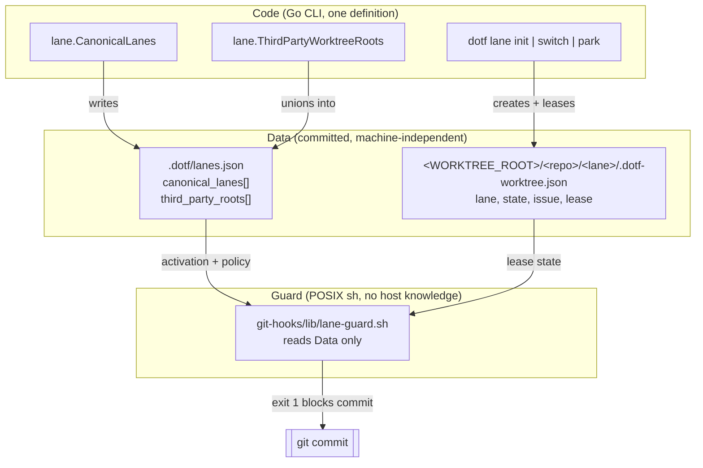
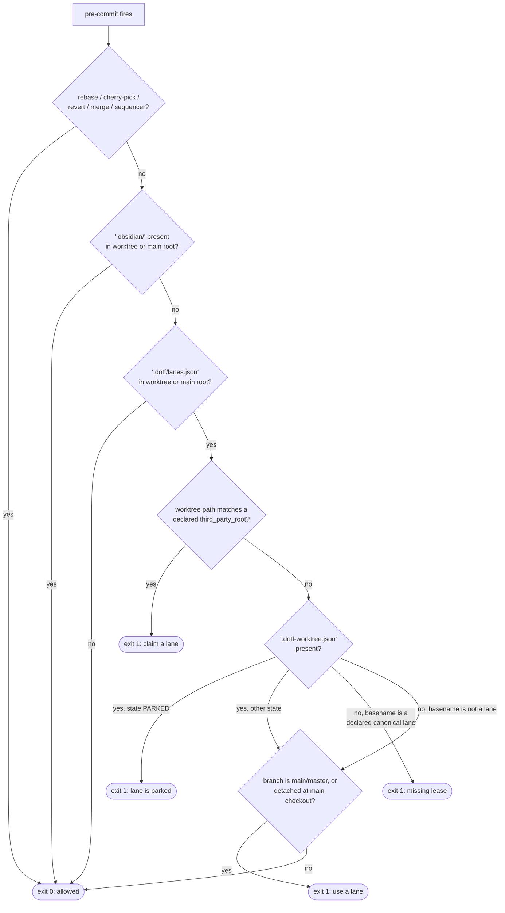
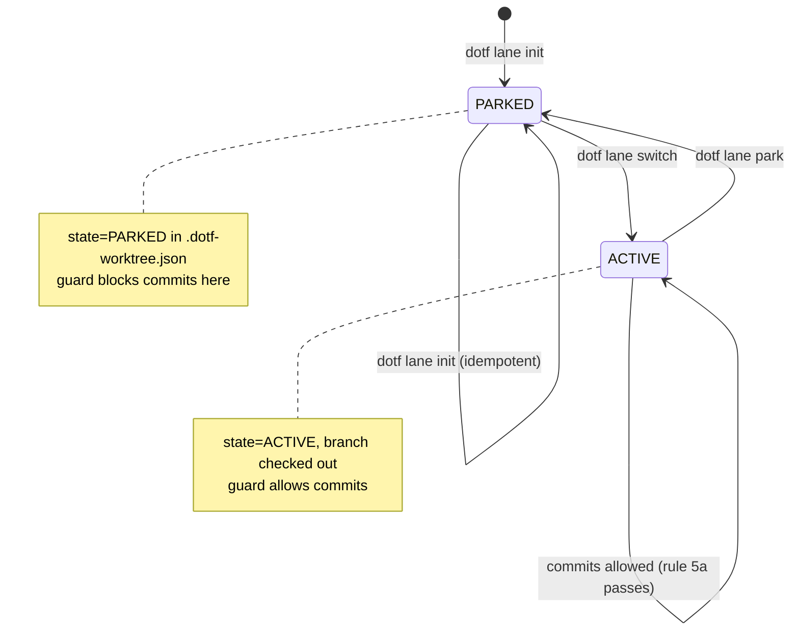

# Persistent named lanes, sticky personas and the pre-commit lane guard

Operational guide for the persistent named lane system (HARNESS-186, ADR-060):
what it is, how it decides, how to activate it in a repository, and how to prove
it works on any OS, agent host and seat.

The system is deliberately agnostic. Nothing in the guard or the marker names a
host, an operating system, an agent or a machine path.

## 1. The three layers



Three properties follow from that split:

- **The marker is the only opt-in.** No other feature's config file can arm the
  guard. `.dotf/lane.json` (singular) belongs to the issue-queue subsystem and is
  ignored here on purpose.
- **Policy is code, host data is data.** `canonical_lanes` is rewritten from
  `lane.CanonicalLanes` on every `dotf lane init`. `third_party_roots` is unioned
  with whatever the file already declares, so adding a session host is a data
  change that survives re-initialization.
- **The guard parses, it does not decide.** It reads two string arrays and the
  lease file. A repository that declares nothing gets no rules.

## 2. The marker contract

Path: `.dotf/lanes.json` at the repository root (or at the main checkout root when
read from a worktree).

```json
{
  "version": 1,
  "canonical_lanes": [
    "feat-lane-primary",
    "feat-lane-secondary",
    "fast-track-lane"
  ],
  "third_party_roots": [
    "copilot-worktrees"
  ]
}
```

| Field | Type | Owner | Semantics |
|---|---|---|---|
| `version` | integer | code | Marker schema version. Currently `1`. |
| `canonical_lanes` | array of string | code | Lane directory names that must carry a lease. Rewritten on every `dotf lane init`. |
| `third_party_roots` | array of string | operator | Directory names, under the projects boundary, that belong to an external session host. Unioned, never truncated. |

Constraints enforced by tests (`cli/internal/lane`, `cli/internal/hooks`):

- Values are bare directory names: no `/`, no `\`, no `:` (`TestLaneInitIdempotent`).
- The file is written indented, one array element per line, because the guard is a
  line-based POSIX parser (`TestLaneInitPreservesDeclaredThirdPartyRoots`).
- The guard's test fixture is generated from `lane.CanonicalLanes` and
  `lane.ThirdPartyWorktreeRoots`, so it cannot drift from production output.

## 3. Guard decision flow

Runs as `pre-commit`, under `bash`, `zsh`, `dash` and BusyBox alike.



Rule summary:

| # | Condition | Verdict |
|---|---|---|
| 1 | Active rebase, cherry-pick, revert, merge or sequencer | allowed |
| 2 | `.obsidian/` in worktree or main root (vault) | allowed |
| 3 | No `.dotf/lanes.json` | allowed — the guard is not armed |
| 4 | Worktree sits under a declared `third_party_root` | **blocked** |
| 5a | `.dotf-worktree.json` present and `state == "PARKED"` | **blocked** |
| 5b | Directory named after a declared lane, no lease file | **blocked** |
| 6a | Branch is `main` or `master` | **blocked** |
| 6b | Detached HEAD at the main checkout, no lease file | **blocked** |

## 4. Lane lifecycle



The WIP cap is part of the same state machine: a `feat/`, `refactor/`, `perf/` or
`build/` branch routes to `feat-lane-primary` then `feat-lane-secondary`; anything
else routes to `fast-track-lane` then `feat-lane-secondary`. If every candidate is
`ACTIVE`, `dotf lane switch` refuses and tells you to park a finished lane first.

## 5. Use cases

| Use case | Command | Marker state | Guard verdict in that worktree |
|---|---|---|---|
| Opt a repository in | `dotf lane init` | created | arms the guard everywhere in the repo |
| Start feature work | `dotf lane switch feat/3259-slug` | unchanged | allowed (ACTIVE lane) |
| Start a fix | `dotf lane switch fix/3300-slug` | unchanged | allowed (`fast-track-lane`) |
| Lane's branch landed | `dotf lane park` | unchanged | **blocked** until a new branch is claimed |
| Fresh agent session container | — | unchanged | **blocked** (declared third-party root) |
| Work on `main` | — | unchanged | **blocked** (rule 6a) |
| Rebase / cherry-pick / revert | `git rebase`, `git cherry-pick` | unchanged | allowed (rule 1) |
| Edit the Obsidian vault | — | n/a | allowed (rule 2) |
| Add a new session host | edit `third_party_roots`, commit | extended | **blocked** for that host only |
| Repository without a marker | — | absent | allowed, guard inert |

## 6. Activation checklist (after the feature merges)

The marker is deliberately **not** committed by the pull request that ships the
code. Shipping the guard and arming it are separate decisions: arming it in the
same merge would block every existing session container on every seat at once.

1. Install the released `dotf` (see `release-dotf.md`).
2. In the main checkout, run `dotf lane init`.
   Expected: `changed=3`, the worktree root printed, and a line naming
   `.dotf/lanes.json`.
3. Review the marker, then commit it:
   `git add .dotf/lanes.json && git commit -m "chore: arm the persistent named lane guard"`.
   The commit itself is allowed: it lands from a lane or before the guard sees a
   marker in the main checkout's history. If rule 6 blocks it, claim a lane with
   `dotf lane switch chore/<issue>-arm-lane-guard` and commit there.
4. Confirm the guard is live (section 7).
5. Announce the change: from that merge onward, commits in third-party session
   roots and on `main` in this repository are refused.

## 7. Validation runbook

Every command below is OS-agnostic and agent-agnostic. Run them from the
repository root.

### 7.1 Static checks

```sh
# The guard must be valid POSIX sh, not bash.
sh -n git-hooks/lib/lane-guard.sh
shellcheck -s sh git-hooks/lib/lane-guard.sh

# Build and vet the CLI.
cd cli && go build ./... && go vet ./... && cd ..
```

### 7.2 Guard behaviour (all ten scenarios, including the agnosticism ones)

```sh
cd cli
go test ./internal/hooks/... -count=1 -timeout 30m -run TestPreCommitLaneGuard -v
```

Expected: `PASS`. The scenarios cover: no marker (allowed), vault (allowed),
`main` with marker (blocked), issue-queue `.dotf/lane.json` only (allowed),
third-party root (blocked), PARKED lane (blocked), ACTIVE lane (allowed),
declared custom root (blocked), undeclared root with no fallback (allowed),
declared non-canonical lane name (blocked).

### 7.3 Marker contract and idempotency

```sh
cd cli
go test ./internal/lane/... -count=1 -timeout 30m \
  -run 'TestLaneInitIdempotent|TestLaneInitPreservesDeclaredThirdPartyRoots|TestLaneSwitchRoutingAndWIPCap' -v
```

Expected: `PASS`. These pin the marker's shape, its machine-independence, the
`third_party_roots` union, the code-owned `canonical_lanes`, and the WIP cap.

### 7.4 Verify by effect on a real repository

```sh
# 1. Opt in.
dotf lane init
test -f .dotf/lanes.json && echo "marker present"

# 2. A commit on main must now be refused.
git checkout main
git commit --allow-empty -m probe
# expect: ERROR: direct commits on 'main' are blocked in lane-managed repository

# 3. A commit in a claimed lane must be allowed.
dotf lane switch chore/0-lane-probe
# prints: lane switch: chore/0-lane-probe -> fast-track-lane (<lane-path>)
cd <lane-path>
git commit --allow-empty -m probe        # expect: succeeds

# 4. Park the lane and confirm the guard blocks it again.
dotf lane park fast-track-lane
git commit --allow-empty -m probe
# expect: ERROR: lane at <lane-path> is PARKED (detached idle state).
```

If step 2 succeeds, the guard is not installed in this seat: check that
`git config --get core.hooksPath` points at a directory containing
`lib/lane-guard.sh`, and that the marker exists in the checkout being tested.

### 7.5 Verify agnosticism

```sh
# The guard must name no host and no lane.
grep -nE 'copilot-worktrees|feat-lane-primary|fast-track-lane' git-hooks/lib/lane-guard.sh
```

Expected: no matches. If that changes, policy has leaked back into the script.

## 8. Known limits

- **The guard is a guardrail, not an enforcement boundary.** `git commit
  --no-verify` bypasses it, and `core.hooksPath` is per-machine, so a seat without
  the deployed hooks has no guard. It exists to make the wrong thing loud, not
  impossible.
- **Rule 5b keys on the directory basename.** A lane created outside
  `<WORKTREE_ROOT>/<repo>/<lane>` without a lease file is not detected. The layout
  is produced by `dotf lane init` itself, so this only bites hand-made lanes.
- **The parser fails closed on syntax and open on semantics.** A malformed marker
  yields empty lists, which means rules 4 and 5 do not apply. `dotf lane init` owns
  the file format; do not hand-edit it beyond `third_party_roots`.
- **Rule 6 blocks `main`/`master` only.** A repository whose default branch is
  named otherwise relies on rules 4 and 5.
