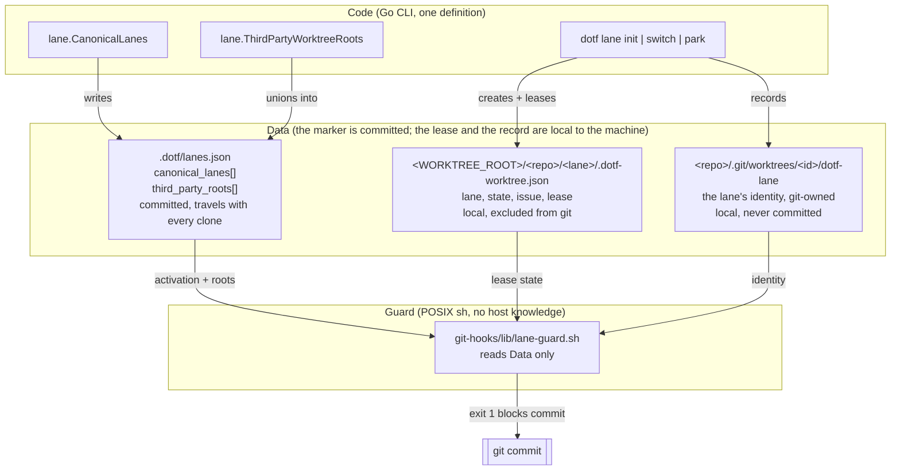
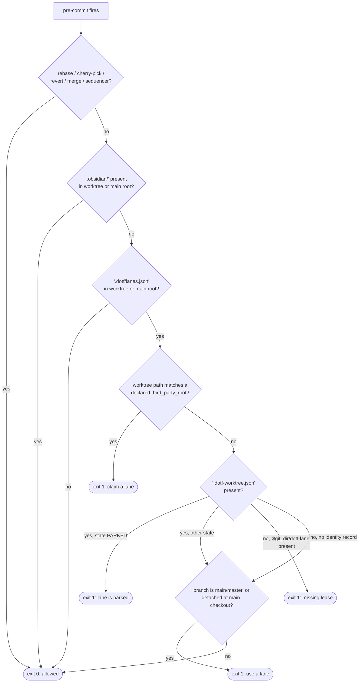
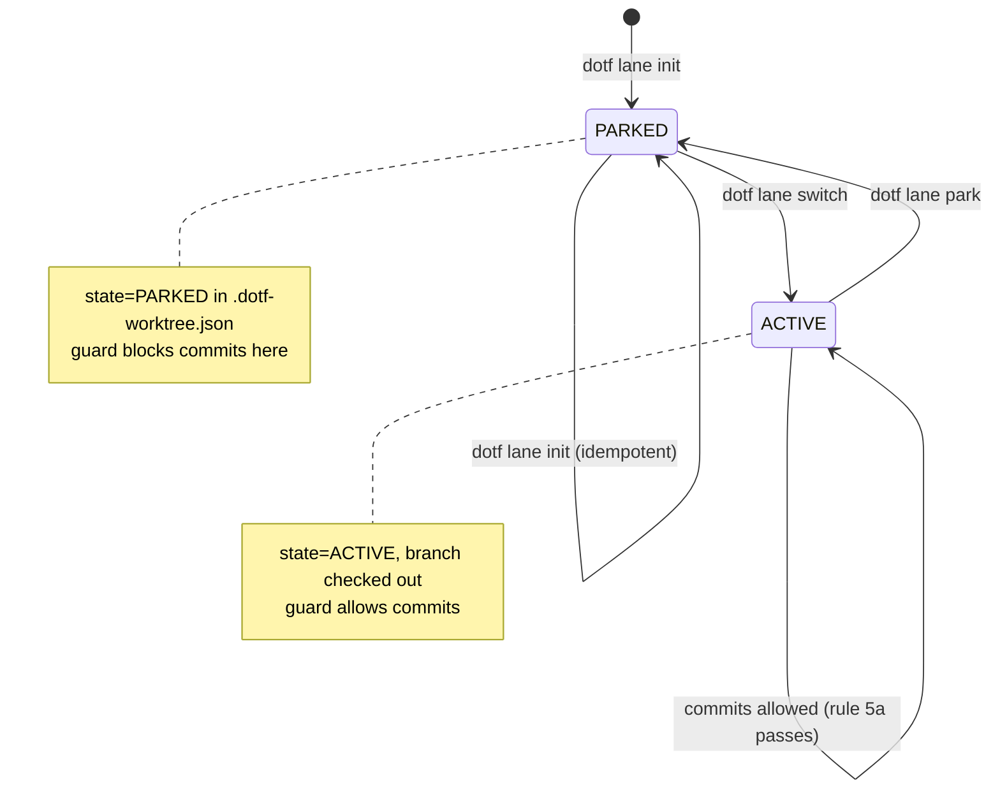

# Persistent named lanes, sticky personas and the pre-commit lane guard

Operational guide for the persistent named lane system (HARNESS-186, ADR-060):
what it is, how it decides, how to activate it in a repository, and how to prove
it works on any OS, agent host and seat.

The system is deliberately agnostic. Nothing in the guard or the marker names a
host, an operating system, an agent or a machine path.

## 1. The three layers



Three properties follow from that split:

- **The marker is the only opt-in.** No other feature's config file can arm the
  guard. `.dotf/lane.json` (singular) belongs to the issue-queue subsystem and is
  ignored here on purpose.
- **Policy is code, host data is data.** `canonical_lanes` is rewritten from
  `lane.CanonicalLanes` on every `dotf lane init`. `third_party_roots` is unioned
  with whatever the file already declares, so adding a session host is a data
  change that survives re-initialization.
- **The guard parses, it does not decide.** It reads the marker's roots, the
  lease file and the identity record. A repository that declares nothing gets no
  rules.
- **A lane's identity is a record, not a name.** `dotf lane init` writes the lane
  name to `dotf-lane` inside the worktree's git admin dir (ADR-061). Git moves
  that directory with `git worktree move`, keeps it through `git gc` and `git
  clean -fdx`, and drops it with `git worktree remove` or `prune`, so the record
  has exactly the worktree's lifetime and stores no path. The guard never matches
  a lane by its directory name.

## 2. The marker contract

Path: `.dotf/lanes.json` at the repository root (or at the main checkout root when
read from a worktree).

```json
{
  "version": 1,
  "canonical_lanes": [
    "feat-lane-primary",
    "feat-lane-secondary",
    "fast-track-lane"
  ],
  "third_party_roots": [
    "copilot-worktrees"
  ]
}
```

| Field | Type | Owner | Semantics |
|---|---|---|---|
| `version` | integer | code | Marker schema version. Currently `1`. |
| `canonical_lanes` | array of string | code | The lanes `dotf lane init` provisions. Rewritten on every init; policy for the CLI, not read by the guard. |
| `third_party_roots` | array of string | operator | Directory names, under the projects boundary, that belong to an external session host. Unioned, never truncated. |

Constraints enforced by tests (`cli/internal/lane`, `cli/internal/hooks`):

- Values are bare directory names: no `/`, no `\`, no `:` (`TestLaneInitIdempotent`).
- The file is written indented, one array element per line, because the guard is a
  line-based POSIX parser (`TestLaneInitPreservesDeclaredThirdPartyRoots`).
- The guard's test fixture is generated from `lane.CanonicalLanes` and
  `lane.ThirdPartyWorktreeRoots`, so it cannot drift from production output.

## 3. Guard decision flow

Runs as `pre-commit`, under `bash`, `zsh`, `dash` and BusyBox alike.



Rule summary:

| # | Condition | Verdict |
|---|---|---|
| 1 | Active rebase, cherry-pick, revert, merge or sequencer | allowed |
| 2 | `.obsidian/` in worktree or main root (vault) | allowed |
| 3 | No `.dotf/lanes.json` | allowed — the guard is not armed |
| 4 | Worktree sits under a declared `third_party_root` | **blocked** |
| 5a | `.dotf-worktree.json` present and `state == "PARKED"` | **blocked** |
| 5b | Identity record `$git_dir/dotf-lane` readable with a non-empty first line, or present but unreadable; no lease file | **blocked** |
| 6a | Branch is `main` or `master` | **blocked** |
| 6b | Detached HEAD at the main checkout, no lease file | **blocked** |

## 4. Lane lifecycle



The WIP cap is part of the same state machine: a `feat/`, `refactor/`, `perf/` or
`build/` branch routes to `feat-lane-primary` then `feat-lane-secondary`; anything
else routes to `fast-track-lane` then `feat-lane-secondary`. If every candidate is
`ACTIVE`, `dotf lane switch` refuses and tells you to park a finished lane first.

## 5. Use cases

| Use case | Command | Marker state | Guard verdict in that worktree |
|---|---|---|---|
| Opt a repository in | `dotf lane init` | created | arms the guard everywhere in the repo |
| Start feature work | `dotf lane switch feat/3259-slug` | unchanged | allowed (ACTIVE lane) |
| Start a fix | `dotf lane switch fix/3300-slug` | unchanged | allowed (`fast-track-lane`) |
| Lane's branch landed | `dotf lane park` | unchanged | **blocked** until a new branch is claimed |
| Fresh agent session container | — | unchanged | **blocked** (declared third-party root) |
| Work on `main` | — | unchanged | **blocked** (rule 6a) |
| Rebase / cherry-pick / revert | `git rebase`, `git cherry-pick` | unchanged | allowed (rule 1) |
| Edit the Obsidian vault | — | n/a | allowed (rule 2) |
| Add a new session host | edit `third_party_roots`, commit | extended | **blocked** for that host only |
| Repository without a marker | — | absent | allowed, guard inert |

## 6. Activation checklist (after the feature merges)

The marker is deliberately **not** committed by the pull request that ships the
code. Shipping the guard and arming it are separate decisions: arming it in the
same merge would block every existing session container on every seat at once.

1. Install the released `dotf` (see `release-dotf.md`).
2. In the main checkout, run `dotf lane init`.
   Expected: `changed=3`, the worktree root printed, and a line naming
   `.dotf/lanes.json`.
3. Review the marker, then commit it:
   `git add .dotf/lanes.json && git commit -m "chore: arm the persistent named lane guard"`.
   The commit itself is allowed: it lands from a lane or before the guard sees a
   marker in the main checkout's history. If rule 6 blocks it, claim a lane with
   `dotf lane switch chore/<issue>-arm-lane-guard` and commit there.
4. Confirm the guard is live (section 7), and that the marker and the lanes
   agree: `dotf lane doctor` prints nothing and exits 0 (section 7.6).
5. Announce the change: from that merge onward, commits in third-party session
   roots and on `main` in this repository are refused.

Lanes provisioned by a `dotf` older than the identity record (ADR-061) carry no
`dotf-lane` file. Re-run `dotf lane init` once after updating: it is idempotent
and reports `changed=3` for the three restored records, then `changed=0`. Until
then the guard treats those lanes as unregistered, which only means rule 5b does
not fire for them. `dotf lane init`, `lane switch` and `lane park` refuse a
directory at a lane path that is not a worktree of the repository they run in,
naming the path and its owner, and a refused init writes no marker; the common
cause is two repositories sharing a basename under one `WORKTREE_ROOT` (#3318).

## 7. Validation runbook

Every command below is OS-agnostic and agent-agnostic. Run them from the
repository root.

### 7.1 Static checks

```sh
# The guard must be valid POSIX sh, not bash.
sh -n git-hooks/lib/lane-guard.sh
shellcheck -s sh git-hooks/lib/lane-guard.sh

# Build and vet the CLI.
cd cli && go build ./... && go vet ./... && cd ..
```

### 7.2 Guard behaviour (all ten scenarios, including the identity ones)

```sh
cd cli
go test ./internal/hooks/... -count=1 -timeout 30m -run TestPreCommitLaneGuard -v
```

Expected: `PASS`. The scenarios cover: no marker (allowed), vault (allowed),
`main` with marker (blocked), issue-queue `.dotf/lane.json` only (allowed),
third-party root (blocked), PARKED lane (blocked), ACTIVE lane (allowed),
declared custom root (blocked), undeclared root with no fallback (allowed),
identity: an unleased worktree merely named after a lane (allowed), the same
worktree once `dotf-lane` is recorded, refused by the guard running as a real
pre-commit hook (blocked), and still blocked after `git worktree move` to a name
the marker never declared.

### 7.3 Marker contract and idempotency

```sh
cd cli
go test ./internal/lane/... -count=1 -timeout 30m \
  -run 'TestLaneInitIdempotent|TestLaneInitPreservesDeclaredThirdPartyRoots|TestLaneSwitchRoutingAndWIPCap' -v
go test ./internal/lane/... -count=1 -timeout 30m \
  -run 'TestIdentity_|TestWriteIdentity_|TestLaneInitRecordsTheIdentity|TestLaneInitRestoresADeleted|TestLaneInitRefuses' -v
```

Expected: `PASS`. The first set pins the marker's shape, its machine-independence,
the `third_party_roots` union, the code-owned `canonical_lanes`, and the WIP cap.
The second pins the identity record: written on every init exit, restored when
deleted (`changed=1`, then `0`), surviving `git worktree move`, and the refusal of
a plain directory or another repository's worktree at a lane path.

### 7.4 Verify by effect on a real repository

```sh
# 1. Opt in.
dotf lane init
test -f .dotf/lanes.json && echo "marker present"

# 2. A commit on main must now be refused.
git checkout main
git commit --allow-empty -m probe
# expect: ERROR: direct commits on 'main' are blocked in lane-managed repository

# 3. A commit in a claimed lane must be allowed.
dotf lane switch chore/0-lane-probe
# prints: lane switch: chore/0-lane-probe -> fast-track-lane (<lane-path>)
cd <lane-path>
git commit --allow-empty -m probe        # expect: succeeds

# 4. Park the lane and confirm the guard blocks it again.
dotf lane park fast-track-lane
git commit --allow-empty -m probe
# expect: ERROR: lane at <lane-path> is PARKED (detached idle state).
```

If step 2 succeeds, the guard is not installed in this seat: check that
`git config --get core.hooksPath` points at a directory containing
`lib/lane-guard.sh`, and that the marker exists in the checkout being tested.

### 7.5 Verify agnosticism

```sh
# The guard must name no host and no lane.
grep -nE 'copilot-worktrees|feat-lane-primary|fast-track-lane' git-hooks/lib/lane-guard.sh
```

Expected: no matches. If that changes, policy has leaked back into the script.

### 7.6 Audit the marker against the lanes

```sh
dotf lane doctor; echo "exit=$?"
```

Expected on a coherent repository: no output, `exit=0`. A repository without the
marker, or a marker whose lanes are not provisioned on this machine, prints one
line and exits 0: the marker is committed and travels with every clone, the lanes
are per machine. Any incoherence prints one `ERROR`/`FIX` pair per finding on
stdout and exits 1; the audit repairs nothing, the FIX line names the command
that does. Exit 2 means the audit could not run (not a git repository).

It reports, in this order and stopping at the first group that fires:

1. The marker: it does not parse, carries an unknown key, a `version` other than
   1, an empty `canonical_lanes` or `third_party_roots`, an entry that is empty,
   duplicated, carries `/` or `\` or starts with a drive prefix, or a
   `canonical_lanes` that differs from the set `dotf lane init` writes.
2. Each declared lane, read from git's own registry of linked worktrees
   (`<repo>/.git/worktrees/*/`, where the identity record lives): registered at
   a path that no longer exists (moved or deleted by hand: `git worktree repair`
   or `git worktree prune`), at a path other than its canonical one (`git
   worktree move` back), recorded in more than one worktree, absent, a directory
   that is not this repository's worktree, a worktree without the record (rule
   5b does not fire there), or a lease missing, naming another lane or in a
   state the lanes do not use.
3. Any worktree whose record names a lane the marker does not declare.

The registry, not `git worktree list` or the canonical path, is what survives a
rename by hand (lesson 581). The Go tests that pin each shape:

```sh
cd cli
go test ./internal/lane/... -count=1 -timeout 30m -run 'TestAuditLanes_' -v
go test ./internal/cmd/... -count=1 -run 'TestLaneDoctor' -v
```

## 8. Known limits

- **The guard is a guardrail, not an enforcement boundary.** `git commit
  --no-verify` bypasses it, and `core.hooksPath` is per-machine, so a seat without
  the deployed hooks has no guard. It exists to make the wrong thing loud, not
  impossible.
- **Rule 5b needs the identity record.** A lane provisioned before ADR-061, or
  re-created by hand with `git worktree add`, carries no `dotf-lane` file and is
  not detected until `dotf lane init` runs again. The guard never writes the
  record: it is a reader. If such a lane was also moved off its canonical path,
  move it back first (`git worktree move <path> <canonical path>`): re-running
  init provisions the canonical path and leaves the moved worktree without a
  record.
- **Lanes are still located by path.** `dotf lane init` finds a lane at
  `<WORKTREE_ROOT>/<repo basename>/<lane>`, so two repositories sharing a basename
  collide there. The second init refuses loudly instead of adopting the first's
  lanes; a layout that lets both coexist is a follow-up.
- **The parser fails closed on syntax and open on semantics.** A malformed marker
  still arms the guard (the file exists) but yields empty lists, so rules 4 and 5a
  do not apply; rule 5b reads the record independently of the lists and still
  fires. `dotf lane init` owns the file format; do not hand-edit it beyond
  `third_party_roots`. `dotf lane doctor` (7.6) is the detector: it names the
  field, the guard stays silent.
- **`dotf lane doctor` reads the main checkout's marker only.** The guard reads
  `$top/.dotf/lanes.json` first, so a lane checked out on a branch whose copy of
  the marker differs is guarded by that copy. An older branch legitimately
  carries an older marker, so the audit does not compare the copies; a corrupt
  lane-local copy is found by running `dotf lane doctor` from that lane after
  merging the branch. The audit is also not yet a `dotf doctor` sweep entry (#3327).
- **Rule 6 blocks `main`/`master` only.** A repository whose default branch is
  named otherwise relies on rules 4 and 5.
