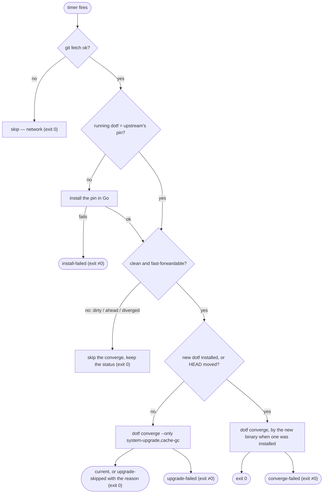

# Runbook: dotfiles self-deploy timer (OPS-001)

> Opt-in automation that keeps a machine converged to `origin/main` by pulling the dotfiles repo
> (fast-forward only) and converging from it (`dotf converge`, whose last step re-runs the setup script on Linux and Windows). Design: [ADR-019](../adr/adr-019-self-deploy-fast-forward-only.md).
> Issues: [#295](https://github.com/mlorentedev/dotfiles/issues/295), [#2502](https://github.com/mlorentedev/dotfiles/issues/2502) (one trigger on every OS, OPS-053).

## What it does

Once a day the timer runs `dotf update` (the Go port of the former
`dotfiles-selfupdate` twins, CLI-027), which:

1. `git fetch`es (a dirty worktree is fetched too: a fetch moves remote-tracking refs only). Offline, it skips
   everything.
2. Reads the `DOTF_VERSION` pin from the **upstream's** `versions.conf` (`git show @{u}:versions.conf`; the checkout's
   own copy when there is no upstream). When the running `dotf` is not that release, it installs it in Go: it
   downloads `dotf_<pin>_<os>_<arch>.tar.gz` (`.zip` on Windows), verifies it against the release `checksums.txt`,
   runs the staged binary's `--version`, and replaces the file it is running from, renaming the old one aside first
   (the only replacement Windows allows for a running `.exe`). This happens on **any** checkout it could fetch, a dirty,
   ahead or diverged one included (CLI-133); `install.sh` and `install.ps1` are not involved.
3. Fast-forwards `main` **only** if it can, and only on a clean worktree; otherwise it skips the converge with the
   reason (dirty, ahead, diverged).
4. On a deployable checkout: converges. After a new `dotf` was installed, the **new binary** converges as a child
   process; otherwise `dotf converge` runs if `HEAD` moved. Its last step re-runs the setup script.
5. On a day `HEAD` did not move and `dotf` is at its pin, runs two steps instead: `dotf converge --only system-upgrade,cache-gc`.
   `system-upgrade` refreshes brew, apt or winget and upgrades the catalog's outdated unpinned system packages
   (TOOL-036). `cache-gc` keeps its own weekly cadence (below), so on most days it reports `not due`. A full
   converge already includes both steps, so neither runs twice.

Every skip exits 0 (benign). A pinned `dotf` that cannot be installed (`install-failed`), a converge that runs and
fails (`converge-failed`), and a failed `system-upgrade` or `cache-gc` step on a quiet day (`upgrade-failed`) exit
non-zero. A refresh that fails offline, or apt without `sudo -n`, is a skip inside the step: it exits 0 and is
recorded as `upgrade-skipped` with the reason, so `dotf doctor` can show that a machine is not upgrading.



### Weekly cache maintenance (`cache-gc`)

The `cache-gc` step (#3367) runs each present tool's own garbage collection once a week, and only the
kind that keeps what is in use:

| Tool | Command | What it removes |
|---|---|---|
| uv (cache not in use) | `uv cache prune` | entries no environment refers to, leftover temp dirs |
| pre-commit | `pre-commit gc` | hook repos no config uses |
| npm | `npm cache verify` | unreferenced cache data |
| docker (daemon answering) | `docker builder prune -f --filter until=168h`, `docker image prune -f --filter until=168h` | build cache and dangling images older than a week; tagged images are kept |
| lima | `limactl prune --keep-referred` | downloads no instance or template refers to |
| colima (running) | `colima ssh -- sudo fstrim -a` | hands the blocks Docker freed back to the host's disk file |

A tool not on PATH is left out, and a daemon that is not running skips its pruners with the reason.
`uv cache prune` needs uv's cache lock to itself, and every running `uvx` holds it shared for as long
as it runs: an MCP server an agent session started holds it for days. The step tries the lock first
and skips uv as `cache in use` instead of waiting out uv's five-minute lock timeout (#3370). A
pruner that fails fails the step and leaves it due, so the next daily run retries it. The stamp is
`$XDG_STATE_HOME/dotfiles/cache-gc/last-run`; delete it to make the step due now. A home volume with
less than 20 GiB free makes the step due whatever the stamp says, and `dotf doctor` warns under the
same threshold (section *Disk space*), naming `dotf converge --only cache-gc` as the remedy. The step's detail
records the free space on the home volume before and after. Left out on purpose: Go's build cache trims
itself, `system-upgrade` already runs `brew cleanup`, and browser and app caches belong to their apps.

Preview with `dotf converge --plan --only cache-gc`; run it now with `dotf converge --only cache-gc`.
On a machine without the `self-deploy` role it runs only when someone runs `dotf converge`.

## Enable / disable

The mechanism is opt-in and default OFF. A machine opts in by declaring the `self-deploy` role in
`~/.config/dotfiles/machine.json`; the `dotf converge` step `self-deploy` then installs the
native trigger, the same daily `~/.local/bin/dotf update` at 03:00 on every OS:

| OS | Trigger | Where |
|---|---|---|
| macOS | launchd agent `com.github.mlorentedev.dotf.self-deploy` | `~/Library/LaunchAgents/`, loaded into `gui/<uid>` |
| Linux | systemd user timer `dotfiles-selfupdate.timer` + oneshot service | `~/.config/systemd/user/` |
| Windows | Scheduled Task `DotfilesSelfUpdate` (S4U when converge runs elevated, InteractiveToken otherwise) | Task Scheduler root |

The trigger carries the `XDG_CONFIG_HOME` and `XDG_STATE_HOME` of the converge that installed it. Without them the 03:00
run would read another `machine.json` and remove itself, or write its record where doctor does not look. launchd and
systemd put them in the job's environment. A Scheduled Task has no per-action environment, so on Windows they are
`dotf update --config-home <dir> --state-home <dir>` arguments, and changing either re-registers the task (#2696).

```bash
# Enable (any OS)
dotf env role add self-deploy
dotf converge --plan --only self-deploy   # what would change
dotf converge --only self-deploy          # install it
dotf converge --only self-deploy          # second run: 0 changes

# Disable: drop the role; the next converge removes the trigger dotf wrote
dotf env role rm self-deploy
dotf converge --only self-deploy
```

Declare the role only with a `dotf` that knows it (newer than 0.73.0): an older release on the same
machine refuses an unknown role, and every `dotf converge` fails until it is updated (lesson 468).

Everything the step writes carries an ownership marker (a header line in the systemd units, a
`[dotf:<digest>]` tag in the task's Description; every agent under the dotf label is dotf's).
Without the role, a marked trigger is removed and an **unmarked one is left in place** and reported.

### Migrating a machine that used `DOTFILES_AUTODEPLOY`

Before OPS-053 the setup scripts installed the trigger when `DOTFILES_AUTODEPLOY=1`. That variable
is gone. A machine that set it keeps its unmarked trigger, and `dotf converge` reports it under
`self-deploy` as installed by a setup script. Adopt it once:

```bash
dotf env role add self-deploy
dotf converge --only self-deploy   # rewrites the units / re-registers the task with the marker
```

### Catch-up differs per scheduler

systemd (`Persistent=true`) and the Task Scheduler (`StartWhenAvailable`) run a slot missed while
the machine was off at the next boot. launchd runs a `StartCalendarInterval` slot missed while the
Mac was **asleep** when it wakes, and skips one missed while it was **powered off**.

## Verify it is active

```bash
dotf doctor                                       # [Self-deploy]: role, trigger and last run
dotf converge --plan --only self-deploy           # 0 changes when the trigger is current
cat ~/.local/state/dotfiles/update/last.json      # the last run: at, status, message, error
# macOS
launchctl print gui/$(id -u)/com.github.mlorentedev.dotf.self-deploy   # spawn type = background, low priority i/o
tail ~/Library/Logs/dotf-self-deploy.log          # the last runs' output
# Linux
systemctl --user list-timers dotfiles-selfupdate.timer
systemctl --user status dotfiles-selfupdate.service   # last run result
systemctl --user show dotfiles-selfupdate.service -p Nice -p IOSchedulingClass -p CPUSchedulingPolicy
```

```powershell
# Windows
Get-ScheduledTask -TaskName DotfilesSelfUpdate
Get-ScheduledTaskInfo -TaskName DotfilesSelfUpdate   # LastRunTime / LastTaskResult
(Get-ScheduledTask -TaskName DotfilesSelfUpdate).Settings.Priority   # 7, below normal
```

The run is unattended, so it runs at background priority and yields CPU and I/O to the user:
launchd's `ProcessType=Background` with `LowPriorityIO`, and systemd's `Nice=19` with idle CPU and
I/O scheduling. The Task Scheduler's default priority, 7, is already below normal, so the task XML
sets nothing (#3367).

Run it once by hand with `dotf update`. On a clean, current checkout whose installed `dotf` matches
the `DOTF_VERSION` pin, it still runs the system-upgrade step (step 5 above), which upgrades any
outdated catalog package on the real machine. On macOS and Windows, preview that first with
`dotf converge --plan --only system-upgrade`. On Linux without passwordless `sudo` the step skips whole, refresh and
listing included, so the preview prints only the `needs root` reason; `apt list --upgradable` shows what is
outdated. When the installed `dotf` is not the upstream's pin, it installs the pin first and the new binary converges.

`install-failed` means the pinned binary did not land: the download, the checksum or the staged binary's
`--version` failed, and the running `dotf` is untouched. `converge-failed` after "installed; its converge failed"
means the pin is in place and a converge step failed: look at that step in the converge report
(`<state dir>/converge/last.json`). The two are separate steps, so the status says which one failed (#3395,
CLI-133). On Windows a `dotf.exe.old` beside `dotf.exe` is the previous binary, still held by a process that was
running it; the next update removes it.

## Diagnose

Every `dotf update`, a skip included, writes `<state dir>/update/last.json` (`$XDG_STATE_HOME/dotfiles`,
else `~/.local/state/dotfiles`). Doctor's `Self-deploy` section reads it: **FAIL** when the last run
failed, **WARN** when there is none yet, when it is older than three days, or when it skipped for a
reason that recurs every night (`dirty`, `diverged`, `no-upstream`, `not-a-repo`, `ff-failed`; the list is
`stuckStatuses` in `cli/internal/update/record.go`).

| Symptom | Likely cause | Action |
|---|---|---|
| doctor: `no run recorded yet` | the trigger was just installed | none: the first run is at 03:00; `dotf update` runs one now |
| doctor: `has not run since` (older than three days) | the machine was off, or the scheduler lost the trigger | `dotf converge --only self-deploy`, then the per-OS commands above |
| `[skip] Dirty worktree` in the journal | uncommitted changes in the repo | commit or stash; the timer resumes next slot |
| `ahead of origin/main ... nothing to deploy` | local commits not pushed yet; `origin/main` has nothing new | none: push when ready; the timer deploys what the upstream holds |
| `[skip] ... diverged ... (non fast-forward)` | local and `origin/main` both have commits the other lacks | reconcile your branch (rebase or merge); non-ff is never auto-resolved. `dotf` itself is still updated to the pin; only the converge waits |
| `[skip] git fetch failed (network?)` | offline / remote unreachable | transient; next slot retries |
| `[skip] No upstream configured` | current branch has no `@{u}` | `git branch --set-upstream-to=origin/main` |
| service shows **failed** | a converge step errored, the setup script included (not a skip) | read `journalctl --user -u dotfiles-selfupdate.service` (macOS: `~/Library/Logs/dotf-self-deploy.log`); the report names the failing step, `~/.local/state/dotfiles/converge/last.json` keeps it, and `converge/runs/<UTC>.log` holds the run's full transcript, subprocess output included |

```bash
# Linux logs
journalctl --user -u dotfiles-selfupdate.service --since today
```

## Override the target repo

`dotf update` resolves the repo via the ADR-025 seam, defaulting to `$HOME/Projects/dotfiles`;
override with `DOTFILES_REPO_DIR`. The setup command converge runs last can be overridden with
`DOTFILES_SELFUPDATE_SETUP_CMD`. It replaces only that last step: the native converge steps
run regardless, so a no-op override no longer makes the timer pull-only.
