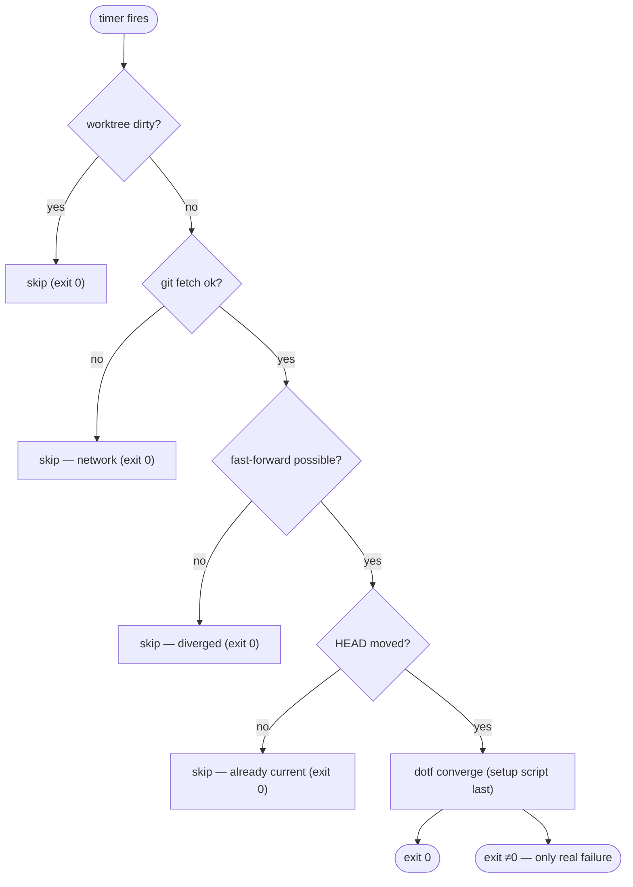

# Runbook: dotfiles self-deploy timer (OPS-001)

> Opt-in automation that keeps a machine converged to `origin/main` by pulling the dotfiles repo
> (fast-forward only) and converging from it (`dotf converge`, whose last step re-runs the setup script on Linux and Windows). Design: [ADR-019](../adr/adr-019-self-deploy-fast-forward-only.md).
> Issues: [#295](https://github.com/mlorentedev/dotfiles/issues/295), [#2502](https://github.com/mlorentedev/dotfiles/issues/2502) (one trigger on every OS, OPS-053).

## What it does

Once a day the timer runs `dotf update` (the Go port of the former
`dotfiles-selfupdate` twins, CLI-027), which:

1. Skips if the repo worktree is **dirty** (uncommitted changes).
2. `git fetch`es; skips on a network failure.
3. Fast-forwards `main` **only** if it can; skips on diverged/non-ff history.
4. Runs `dotf converge` **only if `HEAD` actually moved**. Its last step re-runs the setup script.

Every skip exits 0 (benign). Only a converge that runs and fails exits non-zero.



## Enable / disable

The mechanism is opt-in and default OFF. A machine opts in by declaring the `self-deploy` role in
`~/.config/dotfiles/machine.json`; the `dotf converge` step `self-deploy` then installs the
native trigger, the same daily `~/.local/bin/dotf update` at 03:00 on every OS:

| OS | Trigger | Where |
|---|---|---|
| macOS | launchd agent `com.github.mlorentedev.dotf.self-deploy` | `~/Library/LaunchAgents/`, loaded into `gui/<uid>` |
| Linux | systemd user timer `dotfiles-selfupdate.timer` + oneshot service | `~/.config/systemd/user/` |
| Windows | Scheduled Task `DotfilesSelfUpdate` (S4U when converge runs elevated, InteractiveToken otherwise) | Task Scheduler root |

```bash
# Enable (any OS)
dotf env role add self-deploy
dotf converge --plan --only self-deploy   # what would change
dotf converge --only self-deploy          # install it
dotf converge --only self-deploy          # second run: 0 changes

# Disable: drop the role; the next converge removes the trigger dotf wrote
dotf env role rm self-deploy
dotf converge --only self-deploy
```

Declare the role only with a `dotf` that knows it (newer than 0.73.0): an older release on the same
machine refuses an unknown role, and every `dotf converge` fails until it is updated (lesson 468).

Everything the step writes carries an ownership marker (a header line in the systemd units, a
`[dotf:<digest>]` tag in the task's Description; every agent under the dotf label is dotf's).
Without the role, a marked trigger is removed and an **unmarked one is left in place** and reported.

### Migrating a machine that used `DOTFILES_AUTODEPLOY`

Before OPS-053 the setup scripts installed the trigger when `DOTFILES_AUTODEPLOY=1`. That variable
is gone. A machine that set it keeps its unmarked trigger, and `dotf converge` reports it under
`self-deploy` as installed by a setup script. Adopt it once:

```bash
dotf env role add self-deploy
dotf converge --only self-deploy   # rewrites the units / re-registers the task with the marker
```

### Catch-up differs per scheduler

systemd (`Persistent=true`) and the Task Scheduler (`StartWhenAvailable`) run a slot missed while
the machine was off at the next boot. launchd runs a `StartCalendarInterval` slot missed while the
Mac was **asleep** when it wakes, and skips one missed while it was **powered off**.

## Verify it is active

```bash
dotf doctor                                       # [Self-deploy]: role, trigger and last run
dotf converge --plan --only self-deploy           # 0 changes when the trigger is current
cat ~/.local/state/dotfiles/update/last.json      # the last run: at, status, message, error
# macOS
launchctl print gui/$(id -u)/com.github.mlorentedev.dotf.self-deploy
tail ~/Library/Logs/dotf-self-deploy.log          # the last runs' output
# Linux
systemctl --user list-timers dotfiles-selfupdate.timer
systemctl --user status dotfiles-selfupdate.service   # last run result
```

```powershell
# Windows
Get-ScheduledTask -TaskName DotfilesSelfUpdate
Get-ScheduledTaskInfo -TaskName DotfilesSelfUpdate   # LastRunTime / LastTaskResult
```

Run it once by hand with `dotf update`. On a clean, current checkout it changes nothing, unless the
installed `dotf` is not the checkout's `DOTF_VERSION` pin: then it runs the installer, which
installs the pin and converges.

## Diagnose

Every `dotf update`, a skip included, writes `<state dir>/update/last.json` (`$XDG_STATE_HOME/dotfiles`,
else `~/.local/state/dotfiles`). Doctor's `Self-deploy` section reads it: **FAIL** when the last run
failed, **WARN** when there is none yet, when it is older than three days, or when it skipped for a
reason that recurs every night (`dirty`, `diverged`, `no-upstream`, `not-a-repo`, `ff-failed`; the list is
`stuckStatuses` in `cli/internal/update/record.go`).

| Symptom | Likely cause | Action |
|---|---|---|
| doctor: `no run recorded yet` | the trigger was just installed | none: the first run is at 03:00; `dotf update` runs one now |
| doctor: `has not run since` (older than three days) | the machine was off, or the scheduler lost the trigger | `dotf converge --only self-deploy`, then the per-OS commands above |
| `[skip] Dirty worktree` in the journal | uncommitted changes in the repo | commit or stash; the timer resumes next slot |
| `ahead of origin/main ... nothing to deploy` | local commits not pushed yet; `origin/main` has nothing new | none: push when ready; the timer deploys what the upstream holds |
| `[skip] ... diverged ... (non fast-forward)` | local and `origin/main` both have commits the other lacks | reconcile your branch (rebase or merge); non-ff is never auto-resolved |
| `[skip] git fetch failed (network?)` | offline / remote unreachable | transient; next slot retries |
| `[skip] No upstream configured` | current branch has no `@{u}` | `git branch --set-upstream-to=origin/main` |
| service shows **failed** | a converge step errored, the setup script included (not a skip) | read `journalctl --user -u dotfiles-selfupdate.service` (macOS: `~/Library/Logs/dotf-self-deploy.log`); the report names the failing step, `~/.local/state/dotfiles/converge/last.json` keeps it, and `converge/runs/<UTC>.log` holds the run's full transcript, subprocess output included |

```bash
# Linux logs
journalctl --user -u dotfiles-selfupdate.service --since today
```

## Override the target repo

`dotf update` resolves the repo via the ADR-025 seam, defaulting to `$HOME/Projects/dotfiles`;
override with `DOTFILES_REPO_DIR`. The setup command converge runs last can be overridden with
`DOTFILES_SELFUPDATE_SETUP_CMD`. It replaces only that last step: the native converge steps
run regardless, so a no-op override no longer makes the timer pull-only.
